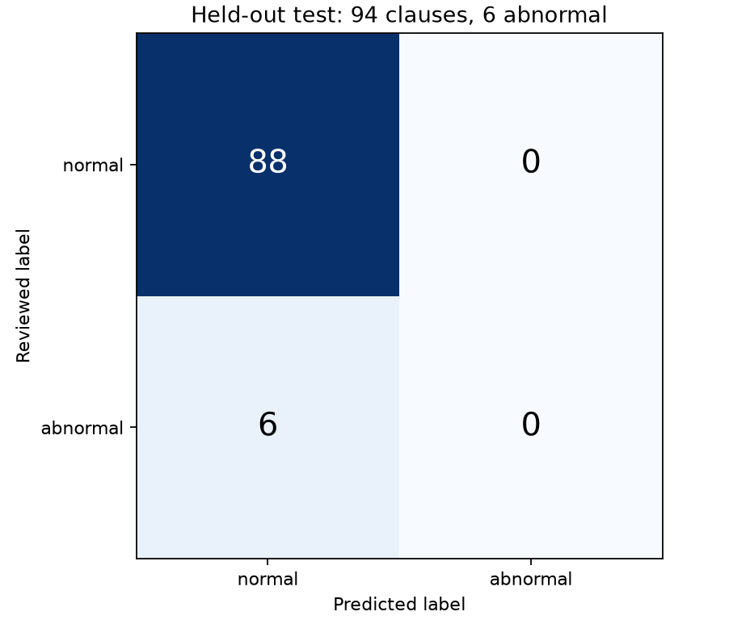
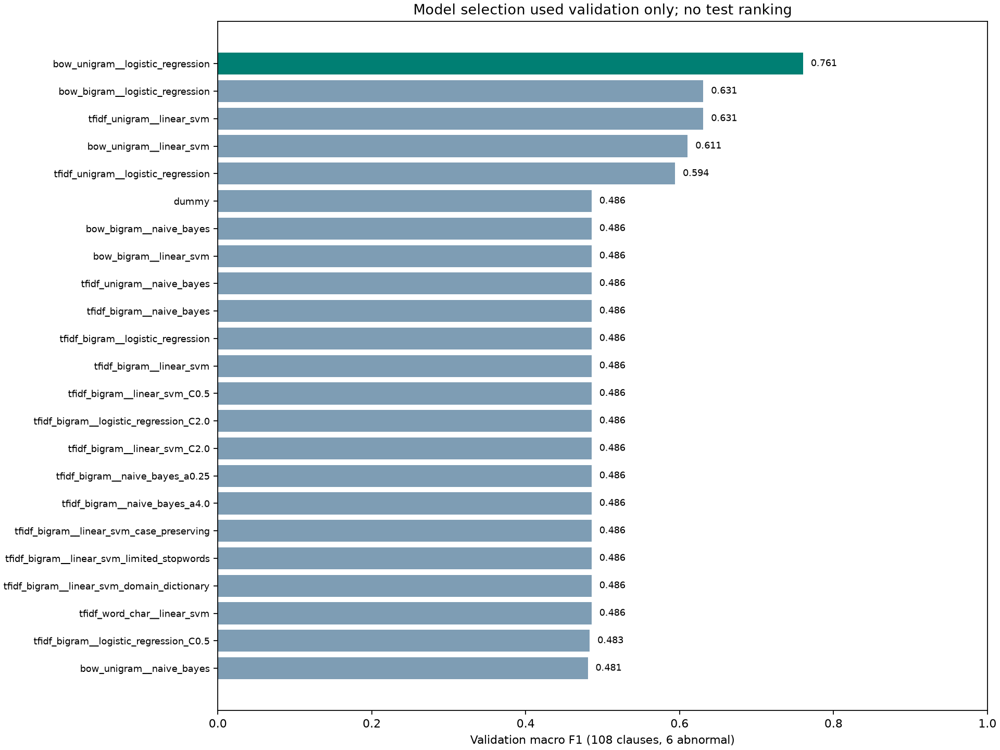

# MVP 1B — thực nghiệm thuê nhà v1

Ngày chạy: 09/11/2026. **MVP 1A được người dùng duyệt; thực nghiệm học máy truyền thống đã chạy, nhưng khả năng phát hiện abnormal chưa đạt. Chưa hoàn thành toàn bộ MVP 1, chưa sang MVP 2.**

## Dữ liệu và quyền thực nghiệm

Người dùng xác nhận đúng câu “Dataset thuê nhà Đạt”. [Hồ sơ duyệt](rental_dataset_approval.json) ghi actor `user_in_chat`; không suy ra tên thật hoặc đánh giá nhãn độc lập của chuyên gia. [Bản được duyệt](../data/rental_approved_v1/clauses.csv) có 517 mẫu, 489 normal/28 abnormal (5,42%), 17 tài liệu nguồn. Giữ nguyên nội dung/nhãn của bản đã trình, chỉ cập nhật trạng thái kiểm duyệt trong snapshot riêng; bản draft và 752 mẫu legacy được bảo toàn.

SHA256 dataset: `19d7554f2b27a754c570ffbb9b8a58dc75a5a053dfa3b5d593717c9541c4c442`. Tiêu chí thuê nhà, nhãn, raw/pages và proof scan SADECO được kiểm tra trước train. Duyệt cho thực nghiệm cục bộ không đồng nghĩa được phép phân phối lại tài liệu nguồn.

## Thiết kế đã chốt trước fit

Train 315 (299 normal,16 abnormal); validation 108 (102,6); test 94 (88,6). Chia theo nhóm tài liệu/họ mẫu/gần trùng, tổng 17 nhóm; không có nhóm đi qua hai tập. Seed mô hình 42, seed chia chọn được 128. Thuật toán cân bằng duyệt 128 seed × các cặp fold bằng số lượng/nhãn/nhóm, không dùng dự đoán hoặc điểm mô hình. Mỗi held-out có tối thiểu 5 abnormal từ ít nhất 2 nhóm. Đây không phải chia ngẫu nhiên độc lập từng điều khoản.

[Precommit](../outputs/rental_mvp1b_v1/precommit.json) và [splits](../outputs/rental_mvp1b_v1/splits.csv) được ghi trước fit: hash dữ liệu/split/code, tham số và cấu hình. 23 ứng viên gồm Dummy và 22 cấu hình BoW/TF-IDF, unigram/bigram, NB/LR/SVM, tham số C/alpha, giữ hoa, stopword hạn chế, ghép từ bằng từ điển hạn chế và word+char. Vectorizer chỉ học trên train ở vòng chọn. Không dùng pretrained hoặc API AI, không đưa lý do/nhãn phụ/nguồn/ID vào features.

Chuẩn hóa Unicode/whitespace, lowercase theo cấu hình; bảo toàn phủ định, con số. Unigram/bigram thông thường là n-gram âm tiết; biến thể từ điển chỉ nối một số cụm định trước, không phải bộ tách từ tiếng Việt tổng quát. Không tuyên bố đã so sánh underthesea/PyVi. Không có oversampling hoặc dữ liệu sinh giả.

Chọn bằng macro F1 validation, ghi [validation_selection](../outputs/rental_mvp1b_v1/validation_selection.json) trước test. Sau đó refit duy nhất ứng viên thắng trên train+validation; đánh giá test một lần cùng Dummy đối chứng. Không thử các mô hình còn lại trên test, không sửa nhãn/chia lại theo kết quả.

## Kết quả thực đo

Ứng viên thắng: **bow_unigram__logistic_regression**, class_weight balanced, C=1; macro F1 validation 0,7605, Recall abnormal 0,50 (3/6). Kết quả test:

| Chỉ số | Giá trị |
|---|---:|
| Accuracy | 0.936170 |
| Precision macro | 0.468085 |
| Recall macro | 0.500000 |
| F1 macro | 0.483516 |
| Precision abnormal | 0 |
| Recall abnormal | 0/6 = 0 |
| F1 abnormal | 0 |

Confusion matrix, thứ tự normal/abnormal: `[[88, 0], [6, 0]]`. Dự đoán toàn bộ test là normal, cùng kết quả với Dummy. **Accuracy 93,62% không chứng minh cảnh báo hữu ích.** Không mẫu test nào có vector toàn 0; các lỗi không phải do inference từ chối hết từ lạ. Lưu/nạp model cho dự đoán giống hệt, nhưng đúng kỹ thuật không có nghĩa đúng nghiệp vụ.

## So sánh validation, không phải test

| Ứng viên | Macro F1 validation | Recall abnormal validation |
|---|---:|---:|
| bow_unigram__logistic_regression | 0.7605 | 0.5000 |
| bow_bigram__logistic_regression | 0.6309 | 0.1667 |
| tfidf_unigram__linear_svm | 0.6309 | 0.1667 |
| bow_unigram__linear_svm | 0.6106 | 0.1667 |
| tfidf_unigram__logistic_regression | 0.5942 | 0.1667 |
| dummy | 0.4857 | 0.0000 |
| bow_bigram__naive_bayes | 0.4857 | 0.0000 |
| bow_bigram__linear_svm | 0.4857 | 0.0000 |
| tfidf_unigram__naive_bayes | 0.4857 | 0.0000 |
| tfidf_bigram__naive_bayes | 0.4857 | 0.0000 |
| tfidf_bigram__logistic_regression | 0.4857 | 0.0000 |
| tfidf_bigram__linear_svm | 0.4857 | 0.0000 |
| tfidf_bigram__linear_svm_C0.5 | 0.4857 | 0.0000 |
| tfidf_bigram__logistic_regression_C2.0 | 0.4857 | 0.0000 |
| tfidf_bigram__linear_svm_C2.0 | 0.4857 | 0.0000 |
| tfidf_bigram__naive_bayes_a0.25 | 0.4857 | 0.0000 |
| tfidf_bigram__naive_bayes_a4.0 | 0.4857 | 0.0000 |
| tfidf_bigram__linear_svm_case_preserving | 0.4857 | 0.0000 |
| tfidf_bigram__linear_svm_limited_stopwords | 0.4857 | 0.0000 |
| tfidf_bigram__linear_svm_domain_dictionary | 0.4857 | 0.0000 |
| tfidf_word_char__linear_svm | 0.4857 | 0.0000 |
| tfidf_bigram__logistic_regression_C0.5 | 0.4833 | 0.0000 |
| bow_unigram__naive_bayes | 0.4808 | 0.0000 |

Có một `ConvergenceWarning` của Liblinear trong vòng fit ứng viên SVM. Lần chạy v1 không ghi riêng warning theo tên ứng viên, vì vậy chưa xác định ứng viên phát cảnh báo; không tuyên bố tất cả SVM hội tụ. Mô hình được chọn là Logistic Regression. Giữ nguyên kết quả v1, không tăng số vòng lặp rồi chọn lại theo test đã xem. Thời gian trong metrics là thời gian trên máy hiện tại, không phải benchmark phần cứng chuẩn.

## Phân tích sáu false negative

Sáu lỗi đến từ 3 nguồn: Cô Chinh (1), mẫu song ngữ Đà Nẵng (1), Roomi (4). Chứa sửa chữa/trách nhiệm không phân định, thu hồi kèm mất cọc, miễn trách nhiệm, mở khóa/di dời tài sản, và chấm dứt khi bị phản ánh ồn. Giữ nguyên toàn bộ nhãn đã duyệt. Mô hình tuyến tính với token không bảo đảm hiểu chủ thể, ngoại lệ và quan hệ giữa căn cứ/hậu quả; ở bộ này điểm validation không chuyển được sang các nguồn test. Đây là nhận định từ quan sát lỗi, chưa là thí nghiệm xác định nguyên nhân.

### cochinh_room1_0009

Nguồn: [cochinh_room1_pdf](https://cochinhquantritaichinh.vn/uploads/hopdong/pdf/mau1_hop_dong_thue_phong_tro_0553_H1VQkQ1n9cXrvg_103448.pdf). Mã dấu hiệu: `repair_burden`. Nhãn đã duyệt abnormal, dự đoán normal.

Bằng chứng nguyên văn: sửa chữa các hư hỏng trong phòng

Lý do đã có trước huấn luyện: Người thuê phải sửa các hư hỏng trong phòng trong khi sử dụng, nếu không thì trừ cọc theo giá thị trường, không phân định lỗi/hao mòn hay phần sửa chữa thuộc chủ nhà. Giá thị trường không tự giải quyết việc chuyển cả hỏng không do người thuê.

### danang_bilingual_0038

Nguồn: [danang_bilingual_docx](https://houserentaldanang.com/wp-content/uploads/2018/12/Hop_dong_thue_nha_song_ngu.docx). Mã dấu hiệu: `broad_liability|repair_burden`. Nhãn đã duyệt abnormal, dự đoán normal.

Bằng chứng nguyên văn: bất kỳ/toàn bộ sự bảo dưỡng

Lý do đã có trước huấn luyện: Người thuê chịu bất kỳ/toàn bộ bảo dưỡng và mất mát thiết bị, nội thất, không phân biệt lỗi/hao mòn. Đã kèm Điều 6: chủ nhà báo trước khi bảo dưỡng và người thuê chịu chi phí do cản trở vô lý; điều đó không thu hẹp nghĩa vụ toàn bộ ở 5.9.

### roomi_registration_0010

Nguồn: [roomi_registration_template](https://roomi.aom.vn/blog/mau-hop-dong-thue-phong-tro-dang-ky-tam-tru-2027). Mã dấu hiệu: `deposit_forfeiture|termination_discretion`. Nhãn đã duyệt abnormal, dự đoán normal.

Bằng chứng nguyên văn: không cần hoàn trả lại tiền cọc

Lý do đã có trước huấn luyện: Sau ba ngày chậm trả, chủ nhà có thể chấm dứt, thu hồi và giữ toàn bộ cọc; không có thông báo/khắc phục hoặc đối soát nợ trước chế tài mất cọc. Cảnh báo sự gộp thu hồi và tịch cọc không dựa trên ngưỡng số ngày tự đặt.

### roomi_registration_0025

Nguồn: [roomi_registration_template](https://roomi.aom.vn/blog/mau-hop-dong-thue-phong-tro-dang-ky-tam-tru-2027). Mã dấu hiệu: `broad_liability`. Nhãn đã duyệt abnormal, dự đoán normal.

Bằng chứng nguyên văn: Bên A không chịu bất cứ trách nhiệm nào

Lý do đã có trước huấn luyện: Miễn bất cứ trách nhiệm nào của chủ nhà đối với hư hỏng/mất tài sản cá nhân, không loại trừ lỗi chủ nhà; phạm vi miễn trách nhiệm rộng hơn yêu cầu tự bảo quản.

### roomi_registration_0058

Nguồn: [roomi_registration_template](https://roomi.aom.vn/blog/mau-hop-dong-thue-phong-tro-dang-ky-tam-tru-2027). Mã dấu hiệu: `access_interference`. Nhãn đã duyệt abnormal, dự đoán normal.

Bằng chứng nguyên văn: mời cơ quan chức năng chứng kiến

Lý do đã có trước huấn luyện: Dù có điều kiện vi phạm nghiêm trọng và thông báo, chủ nhà được tự mở khóa, niêm phong/di dời tài sản để thu hồi; cơ quan chức năng chỉ được mời chứng kiến, không phải cơ chế giải quyết tranh chấp/thi hành quyết định được nêu.

### roomi_registration_0033

Nguồn: [roomi_registration_template](https://roomi.aom.vn/blog/mau-hop-dong-thue-phong-tro-dang-ky-tam-tru-2027). Mã dấu hiệu: `termination_discretion`. Nhãn đã duyệt abnormal, dự đoán normal.

Bằng chứng nguyên văn: phòng khác/hàng xóm phản ánh

Lý do đã có trước huấn luyện: Chỉ cần phòng khác/hàng xóm phản ánh ồn ào là hợp đồng bị hủy; không có bước xác minh vi phạm, nhắc nhở hay khắc phục trước khi mất chỗ ở.

`error_analysis.csv` giữ text đầy đủ, nguồn, lý do cũ và dự đoán. `linear_feature_associations.csv` chỉ là trọng số liên hệ từ của mô hình, không là lời giải thích pháp lý hoặc bằng chứng nhân quả. Abnormal chỉ có 28 mẫu tổng, 16 trong train và 6 trong từng held-out: một mẫu thay đổi Recall held-out 16,67 điểm phần trăm. Thiếu cả ba nhóm deemed_consent, automatic_renewal, overbroad_data_use; không có số đo cho các nhóm vắng mặt. Nhiều nguồn là mẫu công khai, chưa đại diện cho hợp đồng thực tế hay mọi phân khúc.

## Model và inference offline

[Model](../outputs/rental_mvp1b_v1/model.joblib), metadata cùng tên, SHA256 kiểm tra khi nạp; `purpose=official` chỉ là thực nghiệm trên dataset được duyệt, **không phải chứng nhận chất lượng**. Không nạp joblib không tin cậy. CLI và `predict.py` nhận text đầy đủ ngữ cảnh hoặc JSON mảng chuỗi, không tự đọc PDF/tách khoản. Trả normal/abnormal; vector không có feature quen thuộc thì trả needs_review. Confidence null vì chưa hiệu chỉnh xác suất. Nhãn normal không chứng minh điều khoản an toàn.

`offline_inference_inputs.json`, manifest và output minh họa lại ba mẫu test có thật để kiểm tra đường nạp/inference; không gọi đây là tập mới hoặc đánh giá chất lượng độc lập. Không đưa nội dung nguồn lên dịch vụ AI. Biểu đồ có PNG và SVG trong thư mục figures.

## Phần tiếp theo trong MVP 1

Giữ bản v1 làm baseline thất bại có thể kiểm chứng. Ưu tiên tìm thêm điều khoản bất lợi thật, khác nguồn/họ, bổ sung nhóm còn thiếu và cặp dễ nhầm có đủ ngoại lệ; không nhân bản để tăng số lượng. Agent phụ trách trích/nhãn/giải thích, người dùng chỉ duyệt phiên bản mới. Không tự coi phê duyệt v1 là phê duyệt dữ liệu chưa có.

Thực nghiệm tiếp theo phải khai báo trước cách chọn theo train/validation, capture warning từng ứng viên và kiểm tra hội tụ. Test v1 đã xem chỉ dùng phân tích hồi cứu, không còn làm test cuối cho chuỗi tối ưu tiếp theo; cần nguồn test mới chưa dùng lựa chọn khi báo chất lượng phiên bản mới. Chưa chọn ngưỡng/cấu hình theo sáu lỗi này rồi báo test độc lập.

CNN/BiLSTM từ đầu theo master prompt chưa triển khai/huấn luyện. Mốc prompt đặt sau baseline truyền thống ổn định; hiện baseline chưa đạt mục tiêu, dữ liệu train chỉ có 16 abnormal, không có căn cứ hứa deep learning sẽ sửa được. Chưa có metrics DL, chưa hoàn tất yêu cầu này. Chủ đề clause_type tiếp tục là metadata phân tích, không thay nhãn đích rủi ro. Không làm backend, giao diện, truy hồi hay quản lý hợp đồng; chỉ chuyển MVP 2 sau khi người dùng xác nhận MVP 1 đạt và cho phép.
