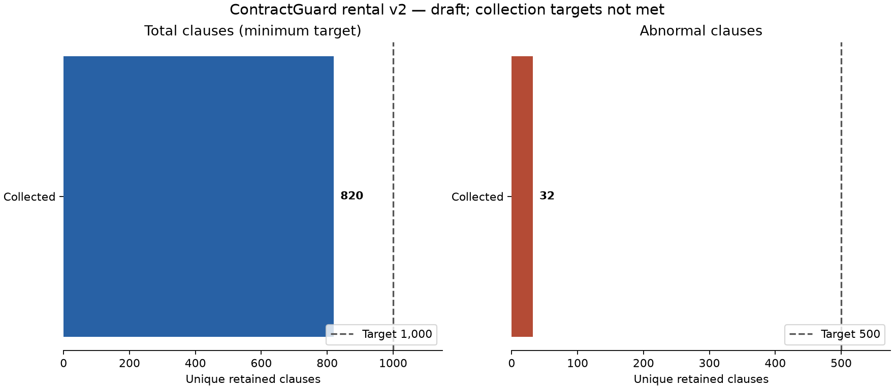

# ContractGuard — hồ sơ mở rộng dữ liệu thuê nhà v2

Ngày cập nhật: **09/11/2026**. Bản nháp có nguồn truy vết; chưa được duyệt và chưa huấn luyện.

**Chưa đạt mục tiêu 1.000–2.000 mẫu và 500 abnormal. Hiện có 820 mẫu: 788 normal / 32 abnormal.**
Còn thiếu tối thiểu 180 mẫu tổng và 468 abnormal. Đây là kết quả thu thập thực tế, không phải tuyên bố hoàn tất yêu cầu số lượng hoặc hoàn tất MVP 1.

## 1. Kết quả có thể kiểm chứng

| Hạng mục | Số lượng |
|---|---:|
| URL khác nhau đã thử tải trong vòng v2 | 121 |
| Tài liệu nguồn tải và trích được trong archive mới | 91 |
| URL chưa đưa được vào archive đã trích | 30 |
| Bản ghi ứng viên kỹ thuật, chưa tự có nhãn | 4500 |
| Điều khoản kế thừa v1, nguyên text/label | 517 |
| Quyết định gán nhãn mới có ID và lý do | 484 |
| Bản lặp được giữ dấu vết, không tính lại | 181 |
| Mẫu mới giữ lại sau khử trùng | 303 |
| Abnormal mới giữ lại | 4 |
| Tài liệu thực sự đóng góp vào CSV v2 | 40 |
| Mẫu hợp đồng/phụ lục đóng góp (theo contract_id) | 42 |
| Nhóm nguồn/họ mẫu dùng ngăn rò rỉ dữ liệu | 27 |
| Nhóm có abnormal / nhóm abnormal mới ngoài v1 | 10 / 1 |

Số tệp tải được không đồng nghĩa số hợp đồng phù hợp. Bản ứng viên gồm cả tiêu đề, tư vấn, metadata và bản chép; chỉ những ID được agent chọn và giải thích mới vào CSV. Nguồn dự trữ chưa được đọc/duyệt đầy đủ không được tính là hợp đồng hợp lệ.

## 2. Nguồn và phương pháp

Kế thừa v1 từ Cổng Chính phủ, đơn vị vận hành nhà ở/ký túc xá, mẫu thuê nhà công khai và mẫu song ngữ. Vòng mới bổ sung nguồn từ cơ sở giáo dục TDTU/NAUE, tệp DOCX/PDF trực tiếp từ các trang mẫu, Wipi, BDSDaily/Đà Nẵng, các phần hợp đồng công khai trên Caselaw, Homedy và bản PDF mang chân trang REVER do RentApartment lưu trữ. Nguồn đăng lại được ghi đúng vai trò, không gọi là hợp đồng thực tế đã ký.
Chi tiết từng tài liệu đóng góp: [sources.json](../data/rental_expansion_v2/sources.json). Từng URL đã thử: [acquisition_inventory.json](../data/rental_expansion_v2/acquisition_inventory.json). Đánh giá trạng thái các nguồn mới: [source_assessment.json](../data/rental_expansion_v2/source_assessment.json).

Quy trình: tìm nguồn → kiểm tra truy cập công khai → lưu bytes và SHA256 → trích DOM/OOXML/PDF → sửa tách/ghép từ nguồn → đọc vai trò, mục đích ở, điều kiện và ngoại lệ → quyết định từng ID → khử trùng và gộp họ → audit spans/hash → xuất draft. Tìm từ khóa chỉ sắp xếp hàng đọc, không sinh ground truth.
Đã sửa bố cục PDF BDSDaily từ nguồn gốc và đối chiếu trực quan bốn trang; sửa giữ câu dẫn vai trò ở HTML/DOCX; bỏ dòng vô hình; loại chữ ký/tiêu đề điều kế tiếp khỏi đơn vị được chọn. Đã xem các trang chứa abnormal mới của RentApartment và cả hai trang CoChinh bổ sung. Bản CoChinh lặp abnormal v1 nên không tính là abnormal mới. Ảnh kiểm tra nằm tại `reports/rental_source_quality_v2`. Không tuyên bố đã kiểm tra trực quan mọi trang của tất cả tệp tải.
Các giới hạn truy cập được giữ nguyên: không vượt robots/login, không đoán nội dung sau preview, không bỏ xác minh TLS. Hai file eLib tải được qua tên miền chính thức không có www sau lỗi chứng thư ở www; hiện nằm trong ứng viên, chưa chọn thêm vào CSV. File Office Mogi bị mã hóa đã giữ bytes và nhận diện EncryptionInfo/EncryptedPackage, không phá mật khẩu; có bản PDF thay thế nhưng không thêm mẫu nếu chỉ là trường trống. Phản hồi Scribd chỉ có metadata/mô tả không đủ nội dung hợp đồng không dùng để gán nhãn.

## 3. Abnormal mới và lý do

Các nhãn sau là đề xuất của agent, chưa có xác nhận chuyên gia độc lập; “abnormal” cảnh báo cơ chế bất lợi theo tiêu chí đã duyệt, không kết luận trái pháp luật.

### `v2_attachment_6e5afb9b6dda_0026`

- Nguồn: [v2_attachment_6e5afb9b6dda](https://wipitools.com/NewsSharing/template_hopdong.docx), đoạn trích OOXML/DOM, vị trí chi tiết trong source_spans.
- Nhóm: `deposit_forfeiture`; độ chắc chắn sơ bộ: `medium`.
- Lý do: Người thuê ngưng trước thời hạn được ghi mất cọc mà không phân biệt lý do, gồm chưa có ngoại lệ khi chủ nhà vi phạm. Đã đọc nhánh chủ nhà phải bồi thường gấp đôi và quyền tranh chấp; đối ứng đó chưa giải quyết ngoại lệ này. Cùng cơ chế với mẫu ACC v1, không khẳng định chấm dứt trước hạn luôn trái luật.
- Ngữ cảnh trong text: `["v2_attachment_6e5afb9b6dda_0027", "v2_attachment_6e5afb9b6dda_0034"]`.

### `v2_rentapartment_lease_0016`

- Nguồn: [v2_rentapartment_lease](https://rentapartment.vn/wp-content/uploads/2019/06/Apartment-lease-contract.pdf), trang PDF 4–6.
- Nhóm: `deposit_forfeiture`; độ chắc chắn sơ bộ: `medium`.
- Lý do: Chậm thanh toán quá 15 ngày dẫn đến chấm dứt và mất toàn bộ quyền đòi cọc, không gắn phần cọc giữ lại với nợ/thiệt hại quyết toán. Đã đọc khoản phạt chậm trả riêng 5.2.2 và quy định kết thúc 7.1.4; cảnh báo cơ chế tước cọc, không suy bất lợi chỉ vì có chậm thanh toán.
- Ngữ cảnh trong text: `["v2_rentapartment_lease_0015", "v2_rentapartment_lease_0034"]`.

### `v2_rentapartment_lease_0028`

- Nguồn: [v2_rentapartment_lease](https://rentapartment.vn/wp-content/uploads/2019/06/Apartment-lease-contract.pdf), trang PDF 5–6.
- Nhóm: `broad_liability`; độ chắc chắn sơ bộ: `medium`.
- Lý do: Ngoài lỗi của người thuê, nghĩa vụ trả chi phí còn bao gồm hư hỏng/mất mát do Bên Thứ Ba gây ra khi sử dụng, không giới hạn bên thứ ba là khách do người thuê mời hoặc có lỗi của người thuê. Đã đọc ngoại lệ hỏng tự nhiên và nghĩa vụ sửa phần xây dựng của chủ nhà; chỉ cảnh báo phạm vi trách nhiệm phần tài sản bên trong.
- Ngữ cảnh trong text: `["v2_rentapartment_lease_0020"]`.

### `v2_rentapartment_lease_0035`

- Nguồn: [v2_rentapartment_lease](https://rentapartment.vn/wp-content/uploads/2019/06/Apartment-lease-contract.pdf), trang PDF 3–7.
- Nhóm: `deposit_forfeiture`; độ chắc chắn sơ bộ: `medium`.
- Lý do: Người thuê báo trước 30 ngày nhưng vẫn mất cả cọc và toàn bộ tiền thuê trả trước cho thời gian chưa dùng, không gắn số giữ với tổn thất thực tế. Đã đưa ngoại lệ chuyển công tác 4.3 và hoàn cọc/tiền trả trước ở 7.2.3 vào text; các ngoại lệ này không giải quyết trường hợp rời đi do chủ nhà vi phạm.
- Ngữ cảnh trong text: `["v2_rentapartment_lease_0011", "v2_rentapartment_lease_0031", "v2_rentapartment_lease_0032", "v2_rentapartment_lease_0033", "v2_rentapartment_lease_0037"]`.

## 4. Phân bố và hạn chế



| Chủ đề phụ | Số mẫu |
|---|---:|
| access | 12 |
| deposit | 25 |
| dispute_resolution | 22 |
| force_majeure | 15 |
| general | 82 |
| handover | 99 |
| liability | 66 |
| modification | 46 |
| notice | 14 |
| payment | 97 |
| personal_data | 20 |
| price_change | 14 |
| renewal | 19 |
| repair | 36 |
| tenant_rights | 55 |
| termination | 88 |
| use_rules | 110 |

| Cơ chế bất lợi | Số mẫu mang dấu hiệu |
|---|---:|
| access_interference | 6 |
| broad_liability | 15 |
| deposit_forfeiture | 10 |
| repair_burden | 4 |
| termination_discretion | 5 |
| unilateral_change | 2 |

Một abnormal có thể có nhiều mã nên tổng cột cơ chế không bằng số abnormal. Chưa có mẫu được chọn cho `deemed_consent`, `automatic_renewal`, `overbroad_data_use`; không ép nhãn cho đủ chín nhóm.
Tỷ lệ abnormal hiện là 3.90%. Các mẫu công khai thiên về hợp đồng chuẩn và sao chép. Chỉ 1 nhóm abnormal mới ngoài v1: tăng số dòng normal chưa giải quyết được thiếu độ đa dạng positive. Mốc 500 là mục tiêu thu thập, không bảo đảm mô hình sẽ tốt.
Giữ riêng cohort ký túc xá/chỗ ở nội trú và thuê dài hạn; không coi chúng đại diện hoàn toàn phòng trọ dân dụng. Các hợp đồng thuê văn phòng/mặt bằng, thuê mua và ví dụ danh tính giả không được dùng để bù chỉ tiêu. Không sinh dữ liệu giả, dịch hợp đồng nước ngoài hay nhân bản positive để báo đủ mẫu.
Không có Accuracy/Precision/Recall/F1 hoặc confusion matrix mới cho v2. Kết quả v1 là lịch sử thí nghiệm trên snapshot cũ; không dùng test v1 để chỉnh nhãn hoặc lựa chọn mô hình mới.

## 5. Kiểm tra và cách mở

JUnit hiện tại: 110 kiểm thử kỹ thuật, 0 thất bại, 0 lỗi, 0 bỏ qua. Đây là kiểm tra code/provenance/gate, không phải độ chính xác gán nhãn hay chất lượng NLP. Hai cảnh báo deprecation SciPy/sklearn xuất hiện ở fixture kỹ thuật của bộ test, không phải kết quả huấn luyện v2.

CSV UTF-8 BOM: [clauses_rental_v2.csv](../data/clauses_rental_v2.csv), mở bằng Excel qua Data → From Text/CSV, encoding UTF-8 và delimiter dấu phẩy để giữ tiếng Việt và các ô nhiều dòng. Bộ dữ liệu v1 được duyệt và `data/clauses.csv` legacy không bị ghi đè.
49 cột gốc được giữ theo thứ tự; thêm metadata phiên bản, nguồn gốc kế thừa, nhóm và mức tiếp xúc split v1. Nhãn/nguồn/lý do có các cột alias đúng schema ban đầu. Xem [data card](../docs/RENTAL_V2_DATA_CARD.md).

```powershell
.venv\Scripts\python.exe -X utf8 tools/review_rental_dataset.py --data data/clauses_rental_v2.csv --label abnormal --origin new --count 10
.venv\Scripts\python.exe -X utf8 tools/review_rental_dataset.py --data data/clauses_rental_v2.csv --start 0 --count 25
.venv\Scripts\python.exe -X utf8 tools/verify_rental_expansion_v2.py
```

Tăng `--start` theo từng đợt để xem toàn bộ; có thể lọc `--source`, `--clause-id`, `--risk`. Công cụ chỉ đọc, không chấp thuận dataset. Danh sách reserve/needs_context là hồ sơ công việc của agent, không yêu cầu người dùng tự sửa trích hoặc nhập nhãn.

## 6. Điều kiện để đi tiếp

Vòng thu thập này chưa đáp ứng mục tiêu số lượng. Cần thêm hợp đồng thuê ở khác họ có đủ nội dung điều khoản, nhất là các cơ chế còn thiếu; các đường tìm tiếp hữu ích là bộ mẫu/điều kiện thuê do đơn vị vận hành công khai hoặc hợp đồng đã được phép dùng và ẩn danh. Không thể suy rằng các hợp đồng khác đều an toàn chỉ vì chưa thu được nhiều abnormal từ nguồn công khai.
Sau khi nguồn và nhãn của bản mở rộng đủ chất lượng, agent trình đúng snapshot để người dùng chỉ xác nhận Đạt/Chưa đạt. Quyết định v1 không phê duyệt v2. Không thay cờ approval hoặc tên reviewer để qua gate.
Đề xuất chia tương lai theo document/họ mẫu/gần trùng, không ngẫu nhiên từng dòng; cố định seed và kiểm tra số positive cùng số nhóm ở từng tập trước fit. Không hứa tỷ lệ 70/15/15 khi chỉ có một nhóm positive mới. `prior_v1_split` và `shares_group_with_v1` chỉ phục vụ quản trị: test v1 đã xem phải coi là hồi cứu, cần nhiều nhóm positive hoàn toàn mới cho test độc lập. Chỉ fit vocabulary trên train và chọn theo validation sau duyệt.
Lab tham khảo và cách áp dụng giữ tại [LAB_MAPPING.md](../docs/LAB_MAPPING.md). Thống kê kiểm duyệt: 517 mẫu v1 có quyết định người dùng thật; toàn bộ 820 dòng trong phiên bản v2 còn pending, chưa có duyệt v2. Chưa sang MVP 2.

Dataset SHA256: `adcecd1ceb5462a640b0f268ce3f93a292d36b1a3c096e4b5334365499c2452a`. Hồ sơ máy đọc: [audit](rental_expansion_v2_audit.json), [snapshot](../data/rental_expansion_v2/review_snapshot.json), [verification](rental_expansion_v2_verification.json).
